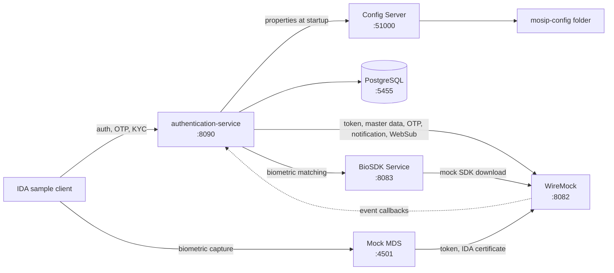

# IDA Local Development Setup Guide

## Contents

- [Introduction and scope](#introduction-and-scope)
- [Setup options](#setup-options)
- [System requirements and prerequisites](#system-requirements-and-prerequisites)
- [Access, configuration, and secrets](#access-configuration-and-secrets)
- [Get the source and prepare the environment](#get-the-source-and-prepare-the-environment)
- [Start and verify the project](#start-and-verify-the-project)
- [Make a change and run tests](#make-a-change-and-run-tests)
- [Daily use and stopping services](#daily-use-and-stopping-services)
- [Data management and reset](#data-management-and-reset)
- [Troubleshooting](#troubleshooting)
- [Next steps](#next-steps)

---

## Introduction and scope

This guide walks you through setting up the ID Authentication (IDA) service locally **without** standing up the full MOSIP platform. All external MOSIP dependencies (database, config server, master-data, biometric SDK) are replaced with lightweight Docker containers provided in the `local-dev-setup/docker-compose/` directory.

This guide is for contributors, developers and testers who want to build, run and test IDA on their own machine. It assumes you are comfortable with a command line, Git, Maven and Docker.

It covers building the repository, running `authentication-service` against local dependencies, trying its APIs with the sample client, and running tests. It does not cover:

- Deploying IDA to a Kubernetes cluster: see [Deployment in the repository README](../../README.md#deployment-in-k8-cluster-with-other-mosip-services).
- The internal APIs, which are [not supported locally](#55-internal-apis-are-not-supported-locally).

### Architecture



`authentication-service`, the sample client and Mock MDS run on your machine. PostgreSQL, Config Server, WireMock and BioSDK Service run in Docker.

### Files in `local-dev-setup/`

| File / Directory | Purpose |
|------------------|---------|
| `prepare-biosdk-mock-lib.sh` | Downloads the mock BioSDK JAR and packages it as `mock-sdk.zip` (macOS/Linux) |
| `prepare-biosdk-mock-lib.bat` | Same as above for Windows |
| `docker-compose/docker-compose.yml` | Starts all required backing services |
| `docker-compose/.env.example` | Template for `docker-compose/.env` (set `MOSIP_CONFIG_PATH`); the real `.env` is git-ignored |
| `docker-compose/init.sql` | Initialises the IDA database schema and seed data (uses the Spring Batch 6 sequence `BATCH_JOB_INSTANCE_SEQ`) |
| `docker-compose/wiremock/mappings/master-data.json` | WireMock stubs for master-data, notification, OTP manager, and WebSub APIs |
| `docker-compose/wiremock/__files/mock-sdk.zip` | Mock BioSDK bundle served to the BioSDK service on startup (**generated** — run `prepare-biosdk-mock-lib.sh/.bat` first) |
| `mosip-ida-ks.p12` | PKCS12 keystore used by the key manager (replaces SoftHSM) |
| `partner-chain.p12` | Partner certificate chain for local testing |
| `partner-mosip-signed.p12` | MOSIP-signed partner certificate for local testing |

---

## Setup options

The backing services always run in Docker Compose. The choices are:

| Choice | Options |
|--------|---------|
| Shell | macOS / Linux shells, or [PowerShell on Windows](#running-the-commands-on-windows-powershell) |
| How to run `authentication-service` | [Maven, JAR, IntelliJ IDEA or VS Code](#53-run-the-authentication-service) |
| How to try the APIs (optional) | [IDA sample client](#6-ida-sample-client-cli) |
| Biometric auth (optional) | [Mock MDS](#7-mock-mds-biometric-capture), used with the sample client |
| API test suites (optional) | [API test rig](#8-run-the-api-test-rig-against-this-setup) |

#### Running the commands on Windows (PowerShell)

The commands in this guide are written for macOS / Linux shells. In PowerShell, change them as follows:

| In this guide | In PowerShell |
|---------------|---------------|
| `-Dgpg.skip=true` and any other `-D` argument | Put the whole argument in quotes: `"-Dgpg.skip=true"` |
| `python3` | `python` or `py` |
| `./prepare-biosdk-mock-lib.sh` | `.\prepare-biosdk-mock-lib.bat` |
| `source .venv/bin/activate` | `.venv\Scripts\activate` |
| `curl` | `curl.exe` (in Windows PowerShell, `curl` is an alias of `Invoke-WebRequest`) |
| `grep --line-buffered "OTP for"` | `Select-String "OTP for"` |

The commands to run the service are given for PowerShell in [5.3](#53-run-the-authentication-service).

---

## System requirements and prerequisites

### Prerequisites

Install the following tools before proceeding:

| Tool | Version |
|------|---------|
| Git | Latest |
| Java | 21 |
| Maven | 3.9.6 |
| Docker + Docker Compose | Latest, and **running** before you start the Docker services (section 4) |
| curl | Latest (used by `prepare-biosdk-mock-lib.sh`) |
| zip | Latest (used by `prepare-biosdk-mock-lib.sh`; on Windows the `.bat` uses PowerShell instead) |
| argon2 native library | Needed for password authentication (kyc-auth v2). macOS: `brew install argon2`. Debian/Ubuntu: `sudo apt-get install libargon2-1`. Windows: see [argon2 library on Windows](#argon2-library-on-windows). See [5.3](#53-run-the-authentication-service) for the `-Djna.library.path` option. |
| Python | 3.10 or later, only for the sample client (section 6) |

> **Apple Silicon note:** the `mosipid/config-server` image is amd64-only, so Docker runs it under emulation on Apple Silicon Macs. This works, but it starts a little slower.

> **HSM note:** This setup uses a **PKCS12 keystore file** (`mosip-ida-ks.p12`) instead of SoftHSM. No external HSM installation is required.

### Hardware and ports

| Resource | Requirement |
|----------|-------------|
| RAM | 8 GB minimum, 16 GB recommended if you also run an IDE and Mock MDS. The four containers use about 2 GB and `authentication-service` about 1 GB. Give Docker at least 4 GB. |
| Free disk | About 15 GB: Docker images (about 3.5 GB), the Maven repository, the build output and the BioSDK mock library. |

The following ports must be free on your machine:

| Port | Used by |
|------|---------|
| `5455` | PostgreSQL |
| `51000` | Config Server |
| `8082` | WireMock |
| `8083` | BioSDK Service |
| `8090` | `authentication-service` |
| `4501` | Mock MDS (biometric auth only) |

### argon2 library on Windows

Windows has no argon2 package. Take the DLL from the `argon2-jvm` jar on Maven Central. Run these PowerShell commands from your workspace folder:

```powershell
curl.exe -L -o argon2-jvm.zip https://repo1.maven.org/maven2/de/mkammerer/argon2-jvm/2.11/argon2-jvm-2.11.jar
Expand-Archive argon2-jvm.zip -DestinationPath argon2-jvm
```

The library is `argon2-jvm\win32-x86-64\argon2.dll`. Pass the full path of that folder in `-Djna.library.path` when you [run the service](#53-run-the-authentication-service).

### Network access

The setup downloads from the internet: the repositories from GitHub, Maven dependencies (including MOSIP `SNAPSHOT` libraries), Docker images, and the BioSDK mock library from Maven Central.

---

## Access, configuration, and secrets

The repositories are cloned over HTTPS in [step 1](#1-clone-the-repositories). Configuration is changed in these places:

| What | Where | Step |
|------|-------|------|
| IDA properties and identity mapping | Your `mosip-config` clone | [3](#3-configure-mosip-config) |
| Path of the `mosip-config` clone | `docker-compose/.env`, copied from `.env.example` | [4](#configure-the-config-server-volume) |
| Auth adapter dependency | `authentication-service/pom.xml` | [5.1](#51-add-the-kernel-auth-adapter-dependency) |
| Config server and local hosts | `authentication-service/src/main/resources/bootstrap.properties` | [5.2](#52-update-bootstrapproperties) |
| Sample client settings | `IDA-sample-client/client/authenticator/authenticator-config-local.toml` | [6.1](#61-review-the-configuration) |

> **Local test values only.** The passwords, secrets, salts, API keys, licence keys and keystores shown in this guide or shipped in `local-dev-setup/` are for this local setup. Never use them in a shared or production environment, and never replace them with real credentials in a file that you might commit.
>
> **Do not commit your local changes** to `authentication-service/pom.xml`, `bootstrap.properties` or the `mosip-config` property files. `docker-compose/.env` is git-ignored.

---

## Get the source and prepare the environment

Follow steps 1 to 4 in order.

### 1. Clone the Repositories

Clone both repositories from the MOSIP GitHub organisation. Use the `develop` branch for both.

```bash
git clone -b develop https://github.com/mosip/mosip-config
git clone -b develop https://github.com/mosip/id-authentication
```

This guide uses the `develop` branch by default. You can check out any other branch of either repository (for example a release or feature branch) and follow the same steps; if that branch differs from what this guide describes, use the README of that branch.

Run the clone commands from a workspace folder of your choice. **Every `cd` command in this guide is relative to that workspace folder** (the folder that contains both clones, and later `mosip-mock-services`), so return to it before copying a `cd` line.

> **Why `master` in section 5.2 but `develop` here?** The service asks the config server for the label `master`, while `mosip-config` is cloned on `develop`. This is fine: the local config server runs in `native` mode and serves the files of the mounted folder, ignoring the label.

### 2. Build the Project

From the root of the `id-authentication` repository, build all modules. The `-Dgpg.skip=true` flag skips GPG signing, which is not required in a local environment. The `-U` flag forces Maven to re-check the snapshot repositories: without it, Maven can reuse an earlier failed lookup of a `SNAPSHOT` dependency (for example `kernel-core:1.4.1-SNAPSHOT`) and fail again even after the cause was fixed.

```bash
cd id-authentication/authentication
mvn clean install -U -Dgpg.skip=true
```

The build runs the unit tests and, on the first run, downloads the dependencies, so it can take 10 minutes or more.

### 3. Configure `mosip-config`

Navigate to your cloned `mosip-config` folder and edit the following property files.

#### 3.1 `application-default.properties`

Update these four URLs to point to the local WireMock mock service (port `8082`):

| Property | Old Value | New Value |
|----------|-----------|-----------|
| `mosip.kernel.masterdata.url` | `http://masterdata.kernel` | `http://localhost:8082` |
| `mosip.kernel.notification.url` | `http://notifier.kernel` | `http://localhost:8082` |
| `mosip.kernel.otpmanager.url` | `http://otpmanager.kernel` | `http://localhost:8082` |
| `mosip.websub.url` | `http://websub.websub` | `http://localhost:8082` |

Also change the internal API URL, which is built with `https` by default:

| Property | Old Value | New Value |
|----------|-----------|-----------|
| `mosip.api.internal.url` | `https://${mosip.api.internal.host}` | `http://localhost:8090` |

> The local service runs on plain `http`. Swagger UI builds its server URL from `mosip.api.internal.url`, so with the default value the **Try it out** calls fail. Change it here in `mosip-config`: the value served by the config server takes precedence over `bootstrap.properties`.

---

#### 3.2 `id-authentication-default.properties`

##### Add these new properties

```properties
mosip.api.public.host=localhost
mosip.mock.biosdk.url=http://localhost:8083
mosip.esignet.host=localhost
spring.http.converters.preferred-json-mapper=jackson2
```

> `spring.http.converters.preferred-json-mapper=jackson2` is required on Spring Boot 4 to keep Jackson 2 for HTTP message conversion. Do **not** carry over the Boot 3-era `spring.mvc.pathmatch.matching-strategy=ANT_PATH_MATCHER` property — remove it if present.
>
> **Keep** `hibernate.dialect=org.hibernate.dialect.PostgreSQLDialect`. If the property is missing, `kernel-core` falls back to `org.hibernate.dialect.MySQL5Dialect`, which Hibernate 7 no longer contains, and the service fails at startup with `ClassNotFoundException: org.hibernate.dialect.MySQL5Dialect`.

##### Change these existing properties

| Property | Old Value | New Value |
|----------|-----------|-----------|
| `mosip.ida.auth.secretKey` | `${mpartner.default.auth.secret}` | `a` |
| `mosip.ida.database.hostname` | `${mosip.database.hostname.override:postgres-postgresql.postgres}` | `localhost` |
| `mosip.ida.database.port` | `${mosip.database.port.override:5432}` | `5455` |
| `mosip.ida.database.user` | `idauser` | `postgres` |
| `mosip.ida.database.password` | `${db.dbuser.password}` | `mosip123` |
| `ida-websub-authtype-callback-secret` | `${ida.websub.authtype.callback.secret}` | `a` |
| `ida-websub-credential-issue-callback-secret` | `${ida.websub.credential.issue.callback.secret}` | `a` |
| `ida-websub-partner-service-callback-secret` | `${ida.websub.partner.service.callback.secret}` | `a` |
| `ida-websub-hotlist-callback-secret` | `${ida.websub.hotlist.callback.secret}` | `a` |
| `ida-websub-masterdata-templates-callback-secret` | `${ida.websub.masterdata.templates.callback.secret}` | `a` |
| `ida-websub-masterdata-titles-callback-secret` | `${ida.websub.masterdata.titles.callback.secret}` | `a` |
| `ida-websub-credential-issue-callback-url` | *(empty)* | `a` |
| `mosip.kernel.keymanager.hsm.config-path` | `/config/softhsm-application.conf` | `<absolute-path-to>/local-dev-setup/mosip-ida-ks.p12` |
| `mosip.kernel.keymanager.hsm.keystore-type` | `PKCS11` | `PKCS12` |
| `mosip.kernel.keymanager.hsm.keystore-pass` | `${softhsm.ida.security.pin}` | `qwerty@1234` |
| `mosip.kernel.tokenid.uin.salt` | `${mosip.kernel.uin.salt}` | `zHuDEAbmbxiUbUShgy6pwUhKh9DE0EZn9kQDKPPKbWscGajMwf` |
| `mosip.kernel.tokenid.partnercode.salt` | `${mosip.kernel.partnercode.salt}` | `yS8w5Wb6vhIKdf1msi4LYTJks7mqkbmITk2O63Iq8h0bkRlD0d` |
| `mosip.ida.allowed.domain.uris` | *(existing value)* | append `,localhost` to the existing value |
| `ida-default-identity-filter-attributes` | `phone,fullName,dateOfBirth,email` | `phone,firstName,middleName,lastName,dateOfBirth,email` |
| `mosip.ida.kyc.token.secret` | `${mosip.ida.kyc.token.secret}` | `j91eRPq0n4zbOZFQ6uBgWMwV7lnV8_2mpRw_sozLSdQ` |

> **Keystore path:** Replace `<absolute-path-to>` with the absolute path to the `local-dev-setup` folder on your machine.  
> Example: `/home/dev/id-authentication/authentication/local-dev-setup/mosip-ida-ks.p12`

---

#### 3.3 `id-authentication-external-default.properties`

| Property | Old Value | New Value |
|----------|-----------|-----------|
| `ida-websub-ca-certificate-callback-secret` | `${ida.websub.ca.certificate.callback.secret}` | `a` |

---

#### 3.4 `id-authentication-otp-default.properties`

> **Required.** The OTP service has been merged into `authentication-service`, but `bootstrap.properties` still loads this file (`spring.cloud.config.name=id-authentication,id-authentication-internal,id-authentication-external,id-authentication-otp`). If you skip this step, the service fails at startup with an unresolved property.

| Property | Old Value | New Value |
|----------|-----------|-----------|
| `ida-websub-ca-certificate-callback-secret` | `${ida.websub.ca.certificate.callback.secret}` | `a` |

---

#### 3.5 `identity-mapping.json`

| Field | Old Value | New Value |
|-------|-----------|-----------|
| `identity.name.value` | `fullName` | `firstName,middleName,lastName` |

### 4. Start Docker Services

The `local-dev-setup/docker-compose/` directory contains a Docker Compose file that starts the following services:

| Service | Port | Description |
|---------|------|-------------|
| PostgreSQL | `5455` | IDA database (pre-seeded via `init.sql`) |
| Config Server | `51000` | Spring Cloud Config Server serving `mosip-config` |
| WireMock (mock-service) | `8082` | Mocks master-data, notification, OTP manager, and WebSub APIs |
| BioSDK Service | `8083` | Mock biometric SDK server |

#### Prerequisite: prepare the BioSDK mock library

The `biosdk-service` downloads a ZIP file containing the mock BioSDK JAR on startup. This file is not stored in the repository (too large for git). Run the provided script **once** before starting Docker services to download the JAR from Maven Central and package it:

**macOS / Linux:**
```bash
cd id-authentication/authentication/local-dev-setup
chmod +x prepare-biosdk-mock-lib.sh
./prepare-biosdk-mock-lib.sh
```

**Windows:**
```cmd
cd id-authentication\authentication\local-dev-setup
.\prepare-biosdk-mock-lib.bat
```

The script downloads `mock-sdk-1.3.0-beta.1-jar-with-dependencies.jar` (~171 MB) from Maven Central, zips it as `mock-sdk.zip`, and places it in `docker-compose/wiremock/__files/`. You only need to run it once; skip it on subsequent starts unless the file is deleted.

#### Configure the Config Server volume

The config-server mounts your cloned `mosip-config` directory. Its path is read from `docker-compose/.env`, so no tracked file needs editing:

```bash
cd id-authentication/authentication/local-dev-setup/docker-compose
cp .env.example .env
# edit .env and set the absolute path of your mosip-config clone, e.g.
# macOS / Linux: MOSIP_CONFIG_PATH=/Users/<you>/mosip-config
# Windows:       MOSIP_CONFIG_PATH=D:/path/to/mosip-config   (use forward slashes)
```

`.env` is git-ignored. `docker compose up` stops with a clear message if `MOSIP_CONFIG_PATH` is not set.

#### Start the services

```bash
cd id-authentication/authentication/local-dev-setup/docker-compose
docker compose up -d
```

The Compose project is named `ida-local`. If you started the stack with an earlier version of this file, see [Troubleshooting](#troubleshooting) before you run this command.

#### Verify all services are running

```bash
docker compose ps
```

All four services (`database`, `config-server`, `mock-service`, `biosdk-service`) should show status `Up`. Only `mock-service` has a health check, so also call the health URL of each of the other services:

```bash
curl http://localhost:51000/config/actuator/health   # Config Server: "status":"UP"
curl http://localhost:8082/__admin/health            # WireMock:      "status" : "healthy"
curl http://localhost:8083/biosdk-service/           # BioSDK:        Service is running...
```

BioSDK Service starts after WireMock is healthy and then downloads the mock library, so it can take about a minute to answer.

#### Verify the seed data

```bash
docker compose exec database psql -U postgres -d mosip_ida -c "SELECT 'identity_cache' AS table_name, count(*) FROM ida.identity_cache UNION ALL SELECT 'partner_data', count(*) FROM ida.partner_data UNION ALL SELECT 'oidc_client_data', count(*) FROM ida.oidc_client_data UNION ALL SELECT 'misp_license_data', count(*) FROM ida.misp_license_data;"
```

Expected counts on a new database:

| Table | Rows | Content |
|-------|------|---------|
| `identity_cache` | 19 | 9 UINs and 10 VIDs (see [Available Identities](#available-identities-uinvid)) |
| `partner_data` | 3 | Partners |
| `oidc_client_data` | 2 | OIDC clients |
| `misp_license_data` | 2 | MISP licences |

If the tables are missing or the counts differ on a new setup, [reset the database](#reset-the-database).

---

## Start and verify the project

Start the service (step 5) and confirm that it is ready. Then, optionally, try the APIs with the sample client (step 6) and Mock MDS (step 7).

### 5. Start the Authentication Service

`authentication-service` is the single consolidated service (public auth/KYC/OTP APIs and the internal APIs). The former `authentication-otp-service` and `authentication-internal-service` no longer exist, so there is only one service to start.

#### 5.1 Add the `kernel-auth-adapter` dependency

The authentication service needs `kernel-auth-adapter` at runtime, but it is not shipped with the service: in deployed environments it is downloaded from the artifactory when the container starts. For a local run, add it explicitly. Open `authentication-service/pom.xml` and add the following as the **last entry** inside the `<dependencies>` block:

```xml
<dependency>
    <groupId>io.mosip.kernel</groupId>
    <artifactId>kernel-auth-adapter</artifactId>
    <version>${kernel-auth-adapter.version}</version>
</dependency>
```

> The version property `${kernel-auth-adapter.version}` is already defined in the parent `pom.xml`. Do **not** hard-code the version. This is a local-only change, so do not commit it. It applies to all the run options in 5.3, and the adapter is packaged into the jar when you build it.
>
> **Keep it last.** The adapter jar contains its own copy of BouncyCastle classes. Declared after the other dependencies, it is loaded after the project's `bcprov-jdk18on`; if the adapter's copy loads first, eKYC responses can return `kycStatus: false`.

#### 5.2 Update `bootstrap.properties`

Open `authentication-service/src/main/resources/bootstrap.properties`. It already contains `spring.profiles.active=default` and `spring.cloud.config.label=master`, so only this value needs to change:

| Property | Old Value | New Value |
|----------|-----------|-----------|
| `spring.cloud.config.uri` | `localhost` | `http://localhost:51000/config` |

Also **add** these four properties (the committed `spring.cloud.config.uri=localhost` is only a placeholder, so the override is mandatory; alternatively pass them as CLI args, e.g. `--spring.cloud.config.uri=http://localhost:51000/config`):

```properties
mosip.api.internal.host=localhost:8090
keycloak.external.url=http://localhost:8082
keycloak.internal.url=http://localhost:8082
spring.cloud.loadbalancer.enabled=false
```

> `spring.cloud.loadbalancer.enabled=false` disables Spring Cloud LoadBalancer so that `@LoadBalanced` clients call `localhost` URLs directly instead of treating `localhost` as a service name (which causes a 503 at startup when the master-data cache is initialised).

#### 5.3 Run the Authentication Service

##### Option A — Maven

```bash
cd id-authentication/authentication/authentication-service
mvn spring-boot:run -Dspring-boot.run.jvmArguments="-Duser.timezone=UTC -Djna.library.path=/opt/homebrew/lib"
```

PowerShell:

```powershell
cd id-authentication\authentication\authentication-service
mvn spring-boot:run "-Dspring-boot.run.jvmArguments=-Duser.timezone=UTC -Djna.library.path=C:/path/to/argon2-jvm/win32-x86-64"
```

##### Option B — JAR

Since `bootstrap.properties` and `authentication-service/pom.xml` were modified after the initial build, rebuild the module first to include the updated configuration and the `kernel-auth-adapter` dependency in the JAR:

```bash
cd id-authentication/authentication/authentication-service
mvn clean install -U -Dgpg.skip=true
java -Duser.timezone=UTC -Djna.library.path=/opt/homebrew/lib -jar target/authentication-service-1.4.0-1764-SNAPSHOT.jar
```

PowerShell:

```powershell
cd id-authentication\authentication\authentication-service
mvn clean install -U "-Dgpg.skip=true"
java "-Duser.timezone=UTC" "-Djna.library.path=C:/path/to/argon2-jvm/win32-x86-64" -jar target\authentication-service-1.4.0-1764-SNAPSHOT.jar
```

> Use the exact jar name. A wildcard such as `authentication-service-*.jar` also matches the `-javadoc` and `-sources` jars, and `java` then fails with `no main manifest attribute`. The version in the name differs between branches, so check the `target` folder.

##### Option C — IntelliJ IDEA

1. Open the `id-authentication/authentication` directory as a Maven project (**File → Open**).
2. Wait for IntelliJ to finish importing and indexing all modules.
3. Navigate to `authentication-service/src/main/java` and open the main application class (`IdAuthenticationApplication.java`).
4. Click the **Run** button (green triangle) next to the class declaration, or right-click the file and choose **Run 'IdAuthenticationApplication'**.
5. To persist the run configuration, open **Run → Edit Configurations**, select the generated configuration, and verify the **Working directory** is set to the `authentication-service` module root.

##### Option D — VS Code

1. Install the **Extension Pack for Java** (`vscjava.vscode-java-pack`) if not already installed.
2. Open the `id-authentication/authentication` folder (**File → Open Folder**).
3. Wait for the Java Language Server to finish building the workspace.
4. Open `authentication-service/src/main/java/.../IdAuthenticationApplication.java`.
5. Click **Run** above the `main` method (shown by the CodeLens link), or press `F5` with the file open.
6. VS Code will auto-generate a launch configuration in `.vscode/launch.json`; you can edit it to add any `-D` JVM arguments if needed.

> **Time zone (`-Duser.timezone=UTC`):** requests carry UTC timestamps and a deployed IDA runs in UTC, so run the local service in UTC too. Without it, time checks can fail on a machine in another time zone. For IntelliJ IDEA and VS Code, add it to the VM options / `vmArgs` of the run configuration.

> **argon2 library path (`-Djna.library.path`):** password authentication loads the native `argon2` library through JNA. Without it, a password request fails with `UnsatisfiedLinkError: Unable to load library 'argon2'`. Pass the folder that contains the library: `/opt/homebrew/lib` on Apple Silicon Macs (as in the examples above), `/usr/local/lib` on Intel Macs, and the [DLL folder](#argon2-library-on-windows) on Windows. On Linux, installing the package (see Prerequisites) is normally enough; otherwise pass its folder the same way. For IntelliJ IDEA and VS Code, add `-Djna.library.path=<folder>` to the VM options / `vmArgs` of the run configuration.

The service starts on port **8090** with context path `/idauthentication/v1`.

Swagger UI is available at:
```
http://localhost:8090/idauthentication/v1/swagger-ui/index.html
```

To save the OpenAPI specification of the running service:

```bash
curl http://localhost:8090/idauthentication/v1/v3/api-docs.yaml -o ida-openapi.yaml
```

#### 5.4 Verify the service has started

The service is ready when the log shows `Started IdAuthenticationApplication in ... seconds`, usually within a minute. Then check its health:

```bash
curl http://localhost:8090/idauthentication/v1/actuator/health
```

The response contains `"status":"UP"`. If the log shows `Application run failed` or `APPLICATION FAILED TO START`, the service did not start; see the error above that line and [Troubleshooting](#troubleshooting).

#### 5.5 Internal APIs are not supported locally

The internal APIs need a token issued by a full Keycloak setup, which this local setup does not provide (WireMock only returns a dummy token for the service's own outgoing calls). This applies to `/internal/auth`, `/internal/verifyidentity`, `/internal/otp`, `/internal/authTransactions/...` and the key manager APIs under `/internal`. For example, a call without a token returns `IDA-MLC-006` (`Missing Input Parameter - Authorization - header`). Test these APIs in a deployed environment.

### 6. IDA Sample Client (CLI)

The `IDA-sample-client` is an interactive Python CLI for testing the OTP, Authentication, KYC and key-binding APIs (all served by the single `authentication-service`) without needing a full MOSIP platform or a UI. It handles request encryption, signing, and all API communication.

#### Folder Structure

```
IDA-sample-client/
├── client/
│   ├── requirements.txt
│   └── authenticator/
│       ├── main.py                          # Entry point
│       ├── authenticator.py                 # Core auth logic
│       ├── cli_options.py                   # Interactive menu
│       ├── authenticator-config-local.toml  # Configuration
│       ├── model/
│       │   └── auth_request.py              # Request models
│       ├── utils/
│       │   ├── captureutil.py               # Mock MDS biometric capture
│       │   ├── cryptoutil.py                # Encryption & signing
│       │   ├── keybindutil.py               # Key binding keys & tokens
│       │   └── restutil.py                  # HTTP calls
│       └── exceptions/
│           └── authenticator_exception.py
├── new-keys/
│   ├── ida-partner-local.cer                # IDA encryption certificate
│   └── partner-mosip-signed.p12             # Partner signing keystore
└── samples/
    └── auth-req-*.json                      # Sample auth payloads (UIN/VID, VID variants, infant, ...)
```

#### Prerequisites

- Python **3.10** or later (the code uses `list[...]` and `X | Y` type hints which require 3.10+)

Verify your Python version:

```bash
python3 --version
```

> **macOS:** the system `python3` is 3.9, which is too old (the client fails with type errors on `list[...]` and `X | Y`). Install a newer Python, for example `brew install python@3.12`, and use `python3.12` to create the virtual environment in section 6.2.

#### 6.1 Review the Configuration

Open `IDA-sample-client/client/authenticator/authenticator-config-local.toml`. The defaults are pre-configured for the local Docker setup — no changes are needed unless you have customised ports or partner credentials.

Key settings to be aware of:

| Setting | Default | Description |
|---------|---------|-------------|
| `ida_auth_url` | `http://localhost:8090/idauthentication/v1/auth` | Authentication service endpoint |
| `ida_otp_url` | `http://localhost:8090/idauthentication/v1/otp` | OTP endpoint (same service as auth) |
| `ida_kyc_auth_v2_url` / `ida_kyc_exchange_v2_url` | `http://localhost:8090/idauthentication/v1/kyc-auth/v2/delegated` / `.../kyc-exchange/v2/delegated` | KYC v2 endpoints (also `ida_ekyc_url`, `ida_kyc_auth_url`, `ida_kyc_exchange_url`, `ida_vci_exchange_url`, `ida_key_binding_url`) |
| `mock_mds_capture_url` | `http://localhost:4501/capture` | Mock MDS capture endpoint used for biometric auth |
| `bound_keys_dir` | `new-keys/bound` | Where key-binding `.p12` files are stored (deleted on clean exit) |
| `encrypt_cert_path` | `new-keys/ida-partner-local.cer` | Certificate used to encrypt the auth request (relative to `IDA-sample-client/`) |
| `sign_p12_file_path` | `new-keys/partner-mosip-signed.p12` | Keystore used to sign the request (relative to `IDA-sample-client/`) |
| `sign_p12_file_password` | `1234` | Password for the signing keystore |
| `partner_id` | `auth_v1z0816154432` | Partner identifier |
| `partner_apikey` | `198833` | Partner API key |
| `partner_misp_lk` | `vM1BA8RosNt3kemNGpsneYgcelZwNmsOoKJQgMm92DltqtJh4p` | MISP licence key |

> **Partner, API key and OIDC client are pre-seeded.** There is no setup step that creates them: `docker-compose/init.sql` already seeds the auth partner `auth_v1z0816154432` (API key `198833`, MISP licence key above), the OIDC partner `mpartner-default-demo-oidc` and its OIDC client `xedG72yecDpJcQbzn6Q8LDplTVGZPhLRXi1ssAh1oW4` (used with `idp_misp_lk`, `auth_partner_id` and `oidc_client_id` in the TOML file). To use a different partner, API key or OIDC client, add it to `init.sql` and [reset the database](#reset-the-database) as described under Data management and reset.

#### 6.2 Set Up a Python Virtual Environment

All commands below must be run from the `IDA-sample-client/` directory. The key file paths in the config are relative to this directory.

```bash
cd id-authentication/authentication/local-dev-setup/IDA-sample-client
```

Create and activate a virtual environment:

```bash
# Create the venv (macOS: use the newer interpreter, e.g. python3.12 -m venv .venv)
python3 -m venv .venv

# Activate — macOS / Linux
source .venv/bin/activate

# Activate — Windows
.venv\Scripts\activate
```

Your prompt will change to show `(.venv)` when the environment is active.

#### 6.3 Install Dependencies

```bash
pip install -r client/requirements.txt
```

> **Python 3.12+ / 3.14 note:** `dynaconf==3.1.9` (the original pinned version) depends on `pkg_resources` which is no longer bundled with Python 3.12+. The `requirements.txt` has been updated to `dynaconf==3.2.4` which resolves this. If you see `ModuleNotFoundError: No module named 'pkg_resources'`, run `pip install "dynaconf==3.2.4"` to fix it.

#### 6.4 Run the Client

Make sure you are still in the `IDA-sample-client/` directory and the venv is active, then run:

```bash
python client/authenticator/main.py
```

You will see the configured IDA URL printed, followed by the main menu:

```
Main Menu:
1. Auth (True/False)
2. eKYC
3. kyc-auth & kyc-exchange/vci-exchange (v1)
4. kyc-auth & kyc-exchange (v2)
5. Identity key binding
0. Exit
```

Each category opens a sub-menu with the auth factors it supports (`0` returns to the main menu).

#### 6.5 Menu Options

| Main menu | Sub-menu actions |
|-----------|------------------|
| 1. Auth (True/False) | Demo auth, Send OTP request, OTP auth, Demo + OTP, Biometric auth |
| 2. eKYC | Same auth factors as above, followed by a KYC request |
| 3. kyc-auth & kyc-exchange / vci-exchange (v1) | Auth factors, then `kyc-auth`, `kyc-exchange` and `vci-exchange` |
| 4. kyc-auth & kyc-exchange (v2) | Auth factors including **Password** and **Key binded token**, then `kyc-auth` v2 and `kyc-exchange` v2 (returns verified-claims metadata when available) |
| 5. Identity key binding | Binds a key to the identity; the key + certificate are stored as a `.p12` under `new-keys/bound/` (deleted on a clean exit) |

##### Demo Auth

Performs a demographic authentication using a sample JSON file.

1. Select a sample file from the `samples/` directory (e.g. `auth-req-01.json`).
2. The client encrypts and signs the request, then sends it to the auth service.
3. The response prints `authStatus: true/false` and any errors.

The sample file format (`samples/auth-req-01.json`):
```json
{
  "vid": "<VID or UIN>",
  "name": [{"language": "eng", "value": "John David Smith"}],
  "gender": [{"language": "eng", "value": "Male"}],
  "dob": "1992/04/15",
  "phoneNumber": "9912993478",
  "emailId": "john.smith@example.com",
  "fullAddress": [{"language": "eng", "value": "123 Main Street"}]
}
```

> **Note:** UIN/VID values are stored hashed in the database, not in plain text. Use only the UIN/VIDs listed in [Available Identities](#available-identities-uinvid). Changing the value to an arbitrary one will result in an authentication failure because the corresponding hash will not be found in the database.

---

##### Send OTP Request

Sends an OTP to the registered mobile/email for a given UIN/VID.

1. Enter a UIN or VID when prompted.
2. The service returns a `transactionID` — **copy this**, you will need it for OTP auth and Demo + OTP.
3. The actual OTP is not delivered (no real notifier is running). IDA sends the OTP message to the WireMock notifier stub, which logs it. Read the OTP from the WireMock logs (run this in `local-dev-setup/docker-compose`):

```bash
docker compose logs -f mock-service | grep --line-buffered "OTP for"
```

The matching log line contains the generated OTP, for example `OTP for UIN XXXXXXXX68 is 582006 and is valid for ...`. Do **not** grep for `GENERATION_SUCCESSFUL`: that matches WireMock's response template for the OTP generation call, which does not contain the OTP that IDA actually used.

---

##### OTP Auth

Authenticates using an OTP received from *Send OTP Request*.

1. Enter the UIN/VID.
2. Enter the OTP from the Docker logs.
3. Enter the `transactionID` returned by *Send OTP Request*.

---

##### Demo + OTP Auth

Combines demographic data and an OTP in a single auth request.

1. Enter the UIN/VID.
2. Enter the OTP from the Docker logs.
3. Enter the `transactionID` from *Send OTP Request*.
4. Select a sample demographic file from the `samples/` directory.

---

##### Biometric Auth

Authenticates using a biometric captured from the **Mock MDS** (see [Section 7](#7-mock-mds-biometric-capture)).

1. Make sure Mock MDS is running.
2. Enter the UIN/VID.
3. Pick a biometric from the list (Face, individual Left/Right fingers, Left/Right Iris).

---

##### Password Auth (kyc-auth v2)

Available under **4. kyc-auth & kyc-exchange (v2)**. Enter the UIN/VID and the password (input is hidden). See the password identities in [Available Identities](#available-identities-uinvid).

---

##### Key Binded Token Auth (kyc-auth v2)

Available under **4**. Uses the key + certificate stored by *5. Identity key binding* for the same UIN/VID, so run key binding first.

---

#### Available Identities (UIN/VID)

The following identities are seeded in the local database. **Not every identity has biometric data**, so pick the identity according to what you want to test (for example, eKYC with face needs face data).

| UIN | Mapped VID(s) | Biometric data | Notes |
|-----|---------------|----------------|-------|
| `8952059168` | – | None | Do not use for eKYC or biometric auth. Demographic details are in `samples/auth-req-01.json`. |
| `8497103958` | `8971487034965918` | None | Do not use for eKYC or biometric auth. Demographic details: `auth-req-02.json` (UIN), `auth-req-05-vid.json` (VID). |
| `8941269276` | `8708548136415038`, `8948612871402917` | None | Do not use for eKYC or biometric auth. Demographic details: `auth-req-03.json` (UIN), `auth-req-06-vid.json` (VID `8708548136415038`), `auth-req-07-vid-1time.json` (VID `8948612871402917`). |
| `8918362358` | `8216925367201389` | None | Do not use for eKYC or biometric auth. Demographic details: `auth-req-04.json` (UIN), `auth-req-08-vid-5trans.json` (VID `8216925367201389`). |
| `8724928329` | `8564539580423608` | Yes | Use for eKYC and biometric auth. Demographic details: `auth-req-09.json` (uses VID `8564539580423608`; no change needed). |
| `8375416927` | `8526937256046298` | Face only (infant) | Infant data. Demographic details: `auth-req-10-infant.json` (VID; change the UIN value to `8375416927` for UIN). |
| `8354720784` | `8420394176306134`, `8021750691607687` | Yes | Use for eKYC and biometric auth. Demographic details: `auth-req-11.json`. |
| `8130162368` | `8694304726328408` | Yes | Use for eKYC and biometric auth. Password identity, password: `Password@123`. No demo sample file; use OTP auth with the seeded demographic data. |
| `8296342506` | `8421783185386241` | Yes | Use for eKYC and biometric auth. Password identity + verified attributes, password: `Password$567`. No demo sample file; use OTP auth with the seeded demographic data. |

> **Biometric format:** the seeded biometric data is in **WSQ** format for finger. Mock MDS must be started with the WSQ image type (see [7.2](#72-configure-and-run-mock-mds)), otherwise finger auth fails with `IDA-BIA-001`.

Several `samples/auth-req-*.json` files already reference these (e.g. `auth-req-05-vid.json` → VID `8971487034965918`, `auth-req-10-infant.json` → VID `8526937256046298`).

---

#### 6.6 Deactivate the Virtual Environment

When done, deactivate the venv:

```bash
deactivate
```

### 7. Mock MDS (Biometric Capture)

Biometric auth from the sample client needs a Mock MDS (Mosip Device Service) that returns captured biometrics. The sample client calls it at `mock_mds_capture_url` (`http://localhost:4501/capture`).

#### 7.1 Check out the code

Use the `develop` branch of [mosip-mock-services](https://github.com/mosip/mosip-mock-services/tree/develop/MockMDS):

```bash
git clone -b develop https://github.com/mosip/mosip-mock-services
cd mosip-mock-services/MockMDS
mvn clean install -Dgpg.skip=true -DskipTests
```

#### 7.2 Configure and run Mock MDS

Mock MDS needs two kinds of configuration before it is started: **properties** that you edit in its `application.properties` file, and three **program arguments** that you pass when you start it.

> Mock MDS reads its properties only from the `application.properties` file in its working directory. Passing them as `-D` JVM options has no effect, so edit the file in the folder you start Mock MDS from:
>
> | How you run it | Working directory and file to edit |
> |----------------|------------------------------------|
> | `run.sh` / `run_auth.bat` | `MockMDS/target/`. The build copies `application.properties`, the scripts and the data folders there, next to the jar and `lib/`. `mvn clean` removes this folder, so repeat your edits after a clean build. |
> | IDE | `MockMDS/` |

##### Step 1 — Edit `application.properties`

Switch the FTM keystores for **face, finger and iris** to the `ida-local` keystore, so the capture is signed with a key that the local IDA trusts. If any of these three is left unchanged, that modality fails with `IDA-MPA-001 Digital signature verification failed`.

```properties
mosip.mock.sbi.file.face.keys.keystorefilename.ftm=/Biometric Devices/Finger/Single/Keys/mosipfingersingleftm-ida-local.p12
mosip.mock.sbi.file.face.keys.keyalias.ftm=mosipfingersingleftm
mosip.mock.sbi.file.face.keys.keystorepwd.ftm=mosipfingersingleftm

mosip.mock.sbi.file.finger.single.keys.keystorefilename.ftm=/Biometric Devices/Finger/Single/Keys/mosipfingersingleftm-ida-local.p12
mosip.mock.sbi.file.finger.single.keys.keyalias.ftm=mosipfingersingleftm
mosip.mock.sbi.file.finger.single.keys.keystorepwd.ftm=mosipfingersingleftm

mosip.mock.sbi.file.iris.single.keys.keystorefilename.ftm=/Biometric Devices/Finger/Single/Keys/mosipfingersingleftm-ida-local.p12
mosip.mock.sbi.file.iris.single.keys.keyalias.ftm=mosipfingersingleftm
mosip.mock.sbi.file.iris.single.keys.keystorepwd.ftm=mosipfingersingleftm
```

Point the auth server and IDA certificate endpoints to the local WireMock (port `8082`). The defaults call a MOSIP environment, which makes capture fail with "IDA Biometric encryption Certificate not found":

```properties
mosip.auth.server.url=http://localhost:8082/v1/authmanager/authenticate/clientidsecretkey
mosip.auth.appid=a
mosip.auth.clientid=a
mosip.auth.secretkey=a

mosip.ida.server.url=http://localhost:8082/idauthentication/v1/internal/getCertificate?applicationId=IDA&referenceId=IDA-FIR
```

##### Step 2 — Pass the program arguments when you start Mock MDS

Start the main class `io.mosip.mock.sbi.test.TestMockSBI` with these three **program arguments**, in this order (they are positional, and they are not `-D` options):

| # | Argument | Value |
|---|----------|-------|
| 1 | `mosip.mock.sbi.device.purpose` | `Auth` (IDA authentication needs the Auth purpose, not `Registration`) |
| 2 | `mosip.mock.sbi.biometric.type` | `Biometric Device` |
| 3 | `mosip.mock.sbi.biometric.image.type` | `WSQ` (the seeded finger data is WSQ; the default `JP2000` makes finger auth fail with `IDA-BIA-001`) |

> **Warning:** use the `WSQ` image type **only for local testing**, to match the WSQ biometric data seeded in the local database. Do **not** use WSQ in a production environment.

Depending on how you run the service, pass them as follows:

- **IDE (for example VS Code `launch.json`):** set `mainClass` to `io.mosip.mock.sbi.test.TestMockSBI` and add the arguments to `args`:

  ```json
  "args": "mosip.mock.sbi.device.purpose=Auth \"mosip.mock.sbi.biometric.type=Biometric Device\" mosip.mock.sbi.biometric.image.type=WSQ"
  ```

  Make sure the working directory (`cwd`) is the `MockMDS` folder so that `MockMDS/application.properties` is picked up.
- **`.sh` / `.bat` script:** edit the arguments at the end of the Java command in the script you use (`run.sh` or `run_auth.bat` in the `MockMDS/target` folder) and run it from that folder. `run_auth.bat` already has the three values; `run.sh` ships with `Registration` and without the image type, so change it. Quote any argument that contains a space.

Once running, Mock MDS listens on `http://localhost:4501`.

---

## Make a change and run tests

### See a source change in the local service

This setup has no hot reload. After you change code:

1. Stop `authentication-service` (`Ctrl+C` in its terminal, or the stop button of your IDE).
2. If you changed a module other than `authentication-service` (for example `authentication-common`) and run the service with Maven or the JAR, install the modules again:

   ```bash
   cd id-authentication/authentication
   mvn clean install -Dgpg.skip=true -DskipTests
   ```

3. Start the service again with one of the [run options](#53-run-the-authentication-service). For the JAR option, rebuild the JAR first.
4. [Verify that the service has started](#54-verify-the-service-has-started), then exercise your change, for example with the [sample client](#6-ida-sample-client-cli).

### Run unit tests

Unit tests do not need the Docker services or a config server. Run all of them:

```bash
cd id-authentication/authentication
mvn test -Dgpg.skip=true
```

To run one test class, run Maven in the module that contains it, after the [build](#2-build-the-project). For example:

```bash
cd id-authentication/authentication/authentication-service
mvn test -Dtest=VciServiceImplTest
```

A successful run ends with `BUILD SUCCESS`. Some tests exercise failure cases, so `ERROR` log lines alone do not mean that a test failed.

### 8. Run the API Test Rig Against This Setup

With the stack and `authentication-service` from sections 4 and 5 running, the IDA API test rig (`api-test/`) can run its smoke and regression suites against this local IDA. The rig needs a few more local settings on top of this guide (extra `mosip-config` values, a WireMock token with roles, BouncyCastle order in `authentication-service/pom.xml`).

Follow **[api-test/README.md → Running Against a Local IDA (Local Run Mode)](../../api-test/README.md#running-against-a-local-ida-local-run-mode)** for the step-by-step setup, the run command and troubleshooting. The rig starts its own mock SBI, so MockMDS from section 7 is not needed for it.

---

## Daily use and stopping services

Once the setup is complete, start the containers, then [run the service](#53-run-the-authentication-service). Run the `docker compose` commands from `local-dev-setup/docker-compose`.

| Task | Command |
|------|---------|
| Start the containers | `docker compose up -d` |
| Check their status | `docker compose ps` |
| Follow the logs of a container | `docker compose logs -f <service>` (`database`, `config-server`, `mock-service` or `biosdk-service`) |
| Stop `authentication-service` | `Ctrl+C` in its terminal, or the stop button of your IDE |
| Stop the containers and keep the database data | `docker compose stop` |
| Start stopped containers again | `docker compose start` |

> **`docker compose down` discards your database changes.** It removes the containers, and the next `docker compose up -d` starts with a new database seeded from `init.sql`. Use `docker compose stop` for a routine shutdown.

Restart `authentication-service` after you change a property in `mosip-config`, because it loads its properties at startup.

### Local Services Reference

| Service | URL |
|---------|-----|
| Config Server | `http://localhost:51000/config` |
| WireMock (mock APIs) | `http://localhost:8082` |
| BioSDK Service | `http://localhost:8083` |
| PostgreSQL | `localhost:5455` |
| Authentication Service (auth, OTP, KYC) | `http://localhost:8090/idauthentication/v1` |
| Mock MDS | `http://localhost:4501` |

---

## Data management and reset

The local database is created and seeded from `docker-compose/init.sql`. See [Verify the seed data](#verify-the-seed-data) for the expected row counts and [Available Identities](#available-identities-uinvid) for the seeded UINs and VIDs.

> **A reset is destructive.** Everything written to the local database since it was seeded is lost, for example locked auth types and transaction records. This guide has no backup procedure, so reset only if you do not need that data.

### Reset the database

To reset the database, for example after changing `init.sql` (run from `docker-compose/`): remove the database container together with its volume, then start it again.

```bash
docker compose rm -s -f -v database
docker compose up -d database
```

`init.sql` runs only when the database data directory is empty, and the database keeps its data in a volume that survives a plain container recreate, so the volume must be removed too. This wipes the local database and re-seeds it from `init.sql`; restart `authentication-service` afterwards so it reconnects.

---

## Troubleshooting

**`docker compose up` reports a container name conflict or `port is already allocated`**  
The containers `my_config_server`, `master_data_mock_service` and `biosdk_service` have fixed names, and the stack uses ports `5455`, `51000`, `8082` and `8083`. Another MOSIP local stack on the same machine may hold them: stop it (`docker compose down` in its folder).  
Earlier versions of this guide ran the stack under the project name `docker-compose`. To remove those old containers, first run `docker compose -p docker-compose ps -a` and confirm that the list shows only IDA containers (another repository can use the same default name), then run `docker compose -p docker-compose down`. The `ida-local` stack starts with a new database.

**Authentication fails with `IDA-MLC-019` (auth type locked)**  
An [API test rig](#8-run-the-api-test-rig-against-this-setup) run leaves some auth types locked on a seeded UIN. [Reset the database](#reset-the-database) and restart `authentication-service`, or use another UIN.

**Windows: the build fails in `VciServiceImplTest` with `Unable to establish loopback connection`**  
This was seen when building from Git Bash. Build from PowerShell or cmd. To continue from the failed module, run `mvn install "-Dgpg.skip=true" -rf :authentication-service` from `id-authentication/authentication`.

**Config server returns 404 for properties**  
Verify that `MOSIP_CONFIG_PATH` in `docker-compose/.env` is the absolute path of your `mosip-config` clone (then run `docker compose up -d` again) and that you have edited the right property files.

**503 errors when calling downstream services**  
This is caused by Spring Cloud LoadBalancer treating `localhost` as a service-registry name. The property `spring.cloud.loadbalancer.enabled=false` is already included in the `bootstrap.properties` steps above for the authentication service. If you still see this error, verify the property is present in the JAR's `bootstrap.properties` (rebuild with `mvn clean install -Dgpg.skip=true` if needed).

**Keystore file not found at startup**  
Double-check the absolute path set in `mosip.kernel.keymanager.hsm.config-path`. Use forward slashes even on Windows.

**BioSDK service fails to start**  
The `biosdk-service` depends on `mock-service` being healthy. Check that the WireMock container started successfully (`docker compose logs mock-service`) before the BioSDK container attempts to download the SDK zip. WireMock's health check runs every 30 seconds, so `biosdk-service` can take up to about a minute to start after WireMock.

---

## Next steps

- [Repository README](../../README.md): build, configuration and deployment overview.
- Questions: [MOSIP Community](https://community.mosip.io/). Bugs: [GitHub issues](https://github.com/mosip/id-authentication/issues). Remove secrets and personal data from logs before you share them.

### References

- [ID Authentication services](https://docs.mosip.io/1.2.0/id-lifecycle-management/identity-verification/id-authentication-services)
- [ID Authentication service developer guide](https://docs.mosip.io/1.2.0/id-lifecycle-management/identity-verification/id-authentication-services/id-authentication-service-developer-guide)
- [API test rig README](../../api-test/README.md)
- [Mock MDS](https://github.com/mosip/mosip-mock-services/tree/develop/MockMDS)
